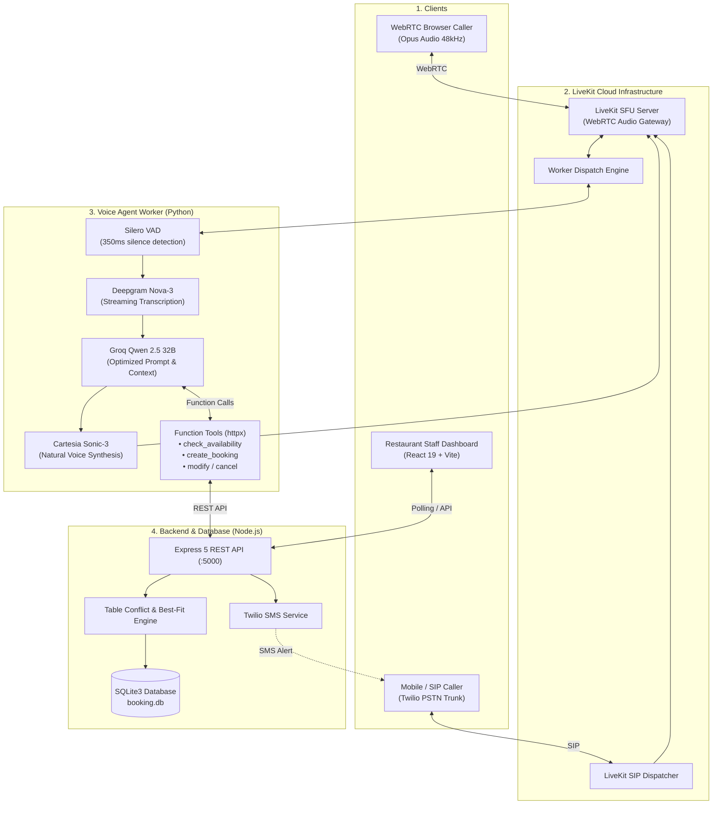
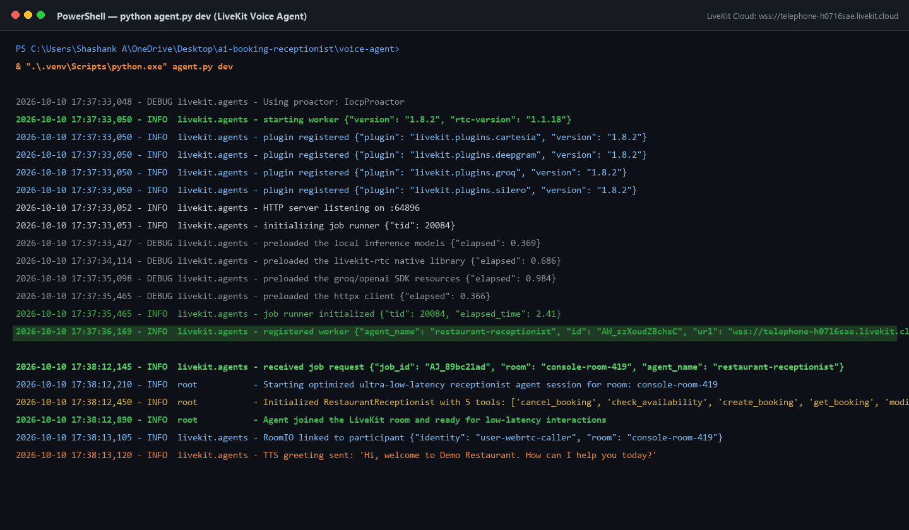
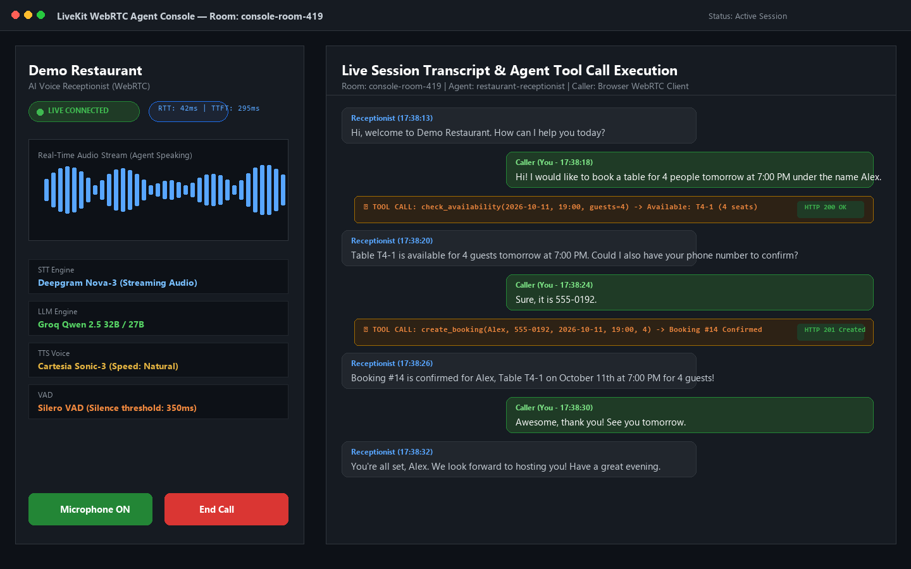
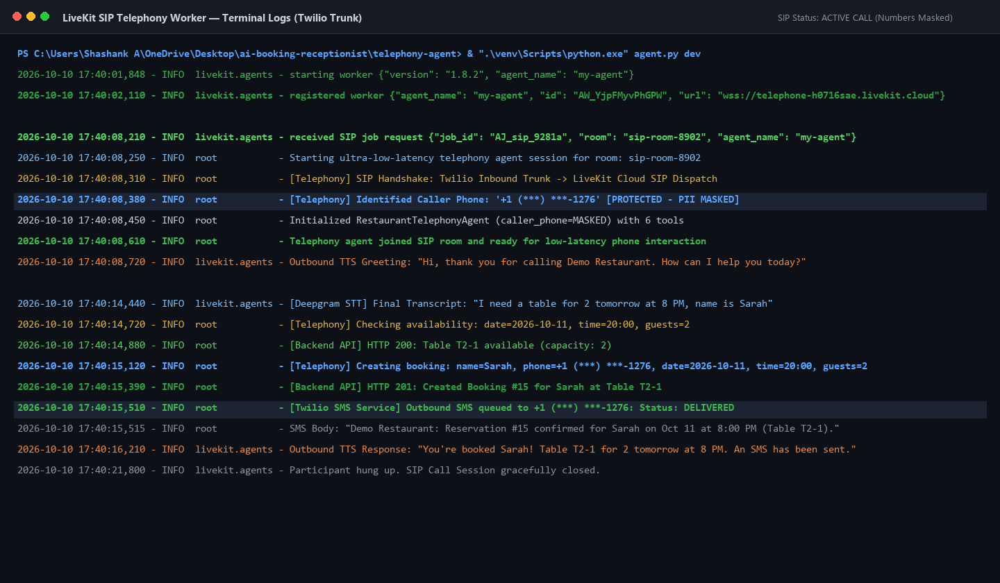
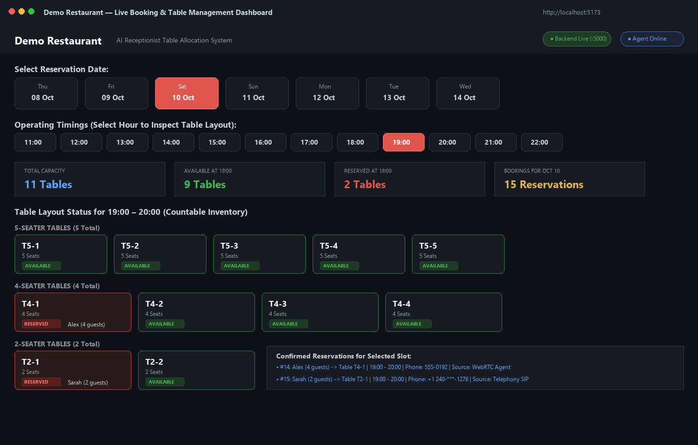
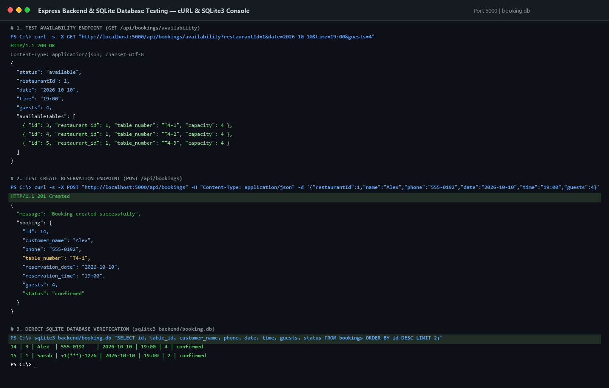
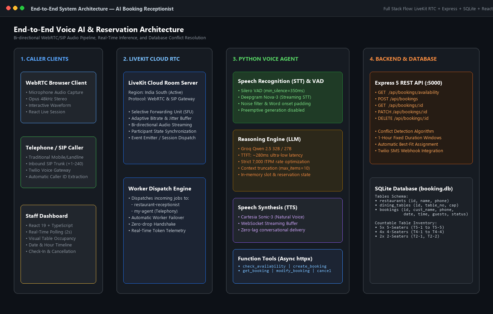

# 🎙️ AI Booking Receptionist

An enterprise-grade, full-stack conversational voice reservation system for restaurants. Powered by **LiveKit Agents**, **Groq (Qwen 2.5)**, **Deepgram Nova-3**, **Cartesia Sonic-3**, an **Express 5 + SQLite** backend, and a real-time **React 19** staff dashboard.

Supports both **WebRTC browser calls** and **inbound telephone (SIP/PSTN) calls** with automated SMS confirmations.

---

## 🌟 Key Features

- **⚡ Ultra-Low Latency Conversational Voice:** Round-trip conversational audio under 600ms (TTFT ~280ms) using Groq LPU inference, Deepgram streaming STT, and Cartesia streaming TTS.
- **📞 Dual-Channel Audio Support:**
  - **WebRTC Agent (`voice-agent/`):** Interactive browser audio sessions with real-time waveform visualization.
  - **Telephony SIP Agent (`telephony-agent/`):** Handles inbound phone calls via Twilio SIP trunking with automatic caller-ID detection.
- **📱 Automated SMS Confirmation:** Automatically dispatches instant reservation confirmations to mobile callers via Twilio SMS.
- **🛡️ Token-Budget & Rate-Limit Optimization:** Engineered sliding window context truncation, terse tool execution feedback, and disabled preemptive generation to stay comfortably within Groq's 7,000 TPM limit.
- **🍽️ Dynamic Conflict-Aware Table Allocation:** Intelligent table selection algorithm with 1-hour reservation windows, preventing double-bookings across 2-seater, 4-seater, and 5-seater tables.
- **📊 Real-Time Staff Dashboard:** React 19 + TypeScript monitoring console displaying live occupancy, timeline navigation, table status badges, and manual check-in actions.

---

## 🏗️ System Architecture



---

## 📸 Screenshots & Evidence

| 1. LiveKit Worker Setup | 2. WebRTC Live Voice Session |
|---|---|
|  |  |

| 3. SIP Telephony & SMS | 4. React Staff Dashboard |
|---|---|
|  |  |

| 5. Backend REST & SQLite | 6. Full System Architecture |
|---|---|
|  |  |

---

## 📁 Repository Structure

```
ai-booking-receptionist/
├── backend/                  # Express 5 + TypeScript + SQLite REST API
│   ├── src/
│   │   └── server.ts         # Endpoints, conflict detection & DB seeding
│   ├── package.json
│   └── tsconfig.json
├── frontend/                 # React 19 + TypeScript + Vite Dashboard
│   ├── src/
│   │   ├── App.tsx           # Table layout, timeline & reservation metrics
│   │   └── index.css
│   ├── package.json
│   └── vite.config.ts
├── voice-agent/              # WebRTC Voice Agent (LiveKit Agents 1.8)
│   ├── agent.py              # Receptionist agent with function tools
│   ├── requirements.txt      # Python dependencies
│   └── .env.example          # Environment variables template
├── telephony-agent/          # SIP Telephony Voice Agent + Twilio SMS
│   ├── agent.py              # Inbound phone agent with Caller-ID extraction
│   ├── requirements.txt      # Python dependencies
│   ├── run_telephony.ps1     # Startup helper script
│   ├── sip_setup_guide.md    # Twilio & LiveKit SIP configuration guide
│   └── .env.example          # Telephony environment template
├── docs/                     # Project submission report & evidence screenshots
│   ├── screenshots/          # High-resolution verification captures
│   └── PROJECT_SUBMISSION_REPORT.md
└── README.md
```

---

## 🚀 Quick Start Guide

### Prerequisites
- **Node.js:** v18+ or v20+
- **Python:** 3.10+ (tested on Python 3.12 / 3.13)
- **LiveKit Cloud Account:** URL, API Key, and Secret ([cloud.livekit.io](https://cloud.livekit.io))
- **Groq API Key:** ([console.groq.com](https://console.groq.com))
- **Deepgram API Key:** ([console.deepgram.com](https://console.deepgram.com))
- **Cartesia API Key:** ([play.cartesia.ai](https://play.cartesia.ai))
- *(Optional)* **Twilio Account:** Account SID, Auth Token, and Phone Number for SMS confirmations.

---

### Step 1: Clone the Repository
```bash
git clone https://github.com/<your-username>/ai-booking-receptionist.git
cd ai-booking-receptionist
```

---

### Step 2: Configure and Start the Backend
```bash
cd backend
npm install
npm run dev
```
The backend starts on `http://localhost:5000` and automatically initializes `booking.db` seeded with Demo Restaurant and 11 dining tables.

---

### Step 3: Start the Staff Dashboard
```bash
cd ../frontend
npm install
npm run dev
```
Open your browser at `http://localhost:5173` to view the live restaurant floor layout and active reservations.

---

### Step 4: Run the WebRTC Voice Agent
```bash
cd ../voice-agent

# Create virtual environment
python -m venv .venv

# Activate virtual environment
# Windows:
.\.venv\Scripts\activate
# Linux/macOS:
source .venv/bin/activate

# Install dependencies
pip install -r requirements.txt

# Configure environment variables
cp .env.example .env
# Edit .env with your LiveKit, Groq, Deepgram, and Cartesia API keys

# Start agent worker in dev mode
python agent.py dev
```
Connect using the [LiveKit Agents Playground](https://agents-playground.livekit.io/) to converse directly with the receptionist.

---

### Step 5 (Optional): Run the Inbound Telephony Agent
```bash
cd ../telephony-agent

python -m venv .venv
.\.venv\Scripts\activate
pip install -r requirements.txt

cp .env.example .env
# Configure Twilio SIP credentials and SMS settings

python agent.py dev
```

---

## ⚙️ Environment Variables

### Voice Agent (`voice-agent/.env`)
| Variable | Description |
|---|---|
| `LIVEKIT_URL` | LiveKit Cloud WebSocket URL (`wss://...livekit.cloud`) |
| `LIVEKIT_API_KEY` | LiveKit project API key |
| `LIVEKIT_API_SECRET` | LiveKit project API secret |
| `GROQ_API_KEY` | Groq Cloud API key for ultra-fast LLM inference |
| `DEEPGRAM_API_KEY` | Deepgram speech-to-text API key |
| `CARTESIA_API_KEY` | Cartesia neural voice synthesis API key |
| `BACKEND_URL` | Backend REST endpoint (`http://localhost:5000/api`) |

### Telephony Agent (`telephony-agent/.env`)
Includes all variables above, plus:
| Variable | Description |
|---|---|
| `LIVEKIT_AGENT_NAME` | SIP worker name registered in LiveKit dispatch (e.g. `my-agent`) |
| `TWILIO_ACCOUNT_SID` | *(Optional)* Twilio account SID for outbound confirmation SMS |
| `TWILIO_AUTH_TOKEN` | *(Optional)* Twilio auth token |
| `TWILIO_PHONE_NUMBER` | *(Optional)* Twilio phone number sending the SMS |
| `RESTAURANT_FRONT_DESK_PHONE` | *(Optional)* Transfer destination for human hand-off |

---

## 🍽️ Restaurant Table Inventory

The restaurant floor layout manages 11 physical tables:

| Table Category | Table Numbers | Capacity |
|---|---|---|
| **5-Seater Tables** | `T5-1`, `T5-2`, `T5-3`, `T5-4`, `T5-5` | 5 Guests |
| **4-Seater Tables** | `T4-1`, `T4-2`, `T4-3`, `T4-4` | 4 Guests |
| **2-Seater Tables** | `T2-1`, `T2-2` | 2 Guests |

- **Best-fit assignment:** A party of 2 is assigned a 2-seater first, keeping 4-seaters and 5-seaters open for larger groups.
- **Reservation windows:** Bookings block a 1-hour window. Subsequent callers requesting the same slot are automatically assigned remaining available tables or offered alternative times.

---

## 📡 REST API Reference

| Method | Endpoint | Description |
|---|---|---|
| `GET` | `/api/restaurants` | List all restaurants |
| `GET` | `/api/tables?restaurantId=1` | List all dining tables and current statuses |
| `GET` | `/api/bookings/availability` | Check slot availability by `date`, `time`, and `guests` |
| `POST` | `/api/bookings` | Create a confirmed reservation with automatic table assignment |
| `GET` | `/api/bookings` | List all reservations |
| `GET` | `/api/bookings/:id` | Retrieve reservation details by ID |
| `PATCH` | `/api/bookings/:id` | Modify reservation time, date, or guest count |
| `DELETE` | `/api/bookings/:id` | Soft-cancel a booking and immediately release the table |

---

## 🛡️ License

This project is licensed under the [MIT License](LICENSE).
